<p align="center">
  
</p>

<h1 align="center">AquaSense AI</h1>
<p align="center"><b>Smart water consumption analytics, potential leak intelligence &amp; demand forecasting</b> · a <a href="https://zubairlabs.com">ZubairLabs</a> portfolio project</p>

<p align="center">
  <a href="https://github.com/muhammadzubair-data/aquasense-ai-water-consumption-intelligence/actions/workflows/ci.yml"></a>
  
  
  
  
  
  
</p>

<p align="center"><i>Live demo: the link and badge are added here after the deployed app has been verified in a browser.</i></p>

> [!IMPORTANT]
> AquaSense AI runs on **synthetic** data by default. Anomalies are *unusual readings* and leak episodes are
> *potential indicators*. Neither is a confirmed leak, and none of the results below are real-world detection or
> forecasting accuracy. The app is a demonstration and is not validated for operational, billing or safety decisions.

---

## Contents
1. [Executive overview](#1-executive-overview)
2. [Business problem and solution](#2-business-problem-and-solution)
3. [Features](#3-features)
4. [System architecture](#4-system-architecture)
5. [Data processing workflow](#5-data-processing-workflow)
6. [Machine-learning methodology](#6-machine-learning-methodology)
7. [Forecasting, anomaly and leak-indicator details](#7-forecasting-anomaly-and-leak-indicator-details)
8. [Dataset documentation](#8-dataset-documentation)
9. [Technology stack](#9-technology-stack)
10. [Application screenshots](#10-application-screenshots)
11. [Evaluation results](#11-evaluation-results)
12. [Installation and quick start](#12-installation-and-quick-start)
13. [Project structure](#13-project-structure)
14. [Automated testing](#14-automated-testing)
15. [GitHub Actions CI](#15-github-actions-ci)
16. [Streamlit deployment](#16-streamlit-deployment)
17. [Limitations and roadmap](#17-limitations-and-roadmap)
18. [Author](#18-author)

---

## 1. Executive overview

AquaSense AI is an eight-module Streamlit application for hourly water-meter data. It shows:
- where and when water is used
- which readings are unusual for that hour of the day
- which meters show sustained excess consumption, ranked by whether night flow rose too (the pattern a continuous leak leaves)
- what demand to expect over the next 6–72 hours

| | |
|:--|:--|
| **Modules** | Command Center, Consumption Analytics, Anomaly Detection, Potential Leak Intelligence, Demand Forecasting, Meter Intelligence, Data Explorer, Methodology |
| **Models** | Context-aware Isolation Forest; hour-aware sustained-excess episodes with night-flow priority; Random Forest forecaster with lag features |
| **Evaluation** | Chronological 80/20 holdout; recursive day-ahead backtest vs two baselines; synthetic ground truth for leaks and legitimate bursts |
| **Headline (synthetic, realistic profile)** | Higher-priority indicators found **2 of 2** injected leaks with **0** non-matching episodes. They did the same on 4 seeds × 2 profiles in CI. Forecast MAE is 2.6–5.5 L/h per meter, lower than both baselines on all 9 series |
| **Data handling** | Messy CSVs repaired and reported: units, time zones, duplicates, sub-hourly data, gaps. Uploads stay in the browser session |
| **Quality** | 72 pytest tests (the original 9 unchanged), a Playwright browser test, and GitHub Actions on Python 3.11 and 3.12 |

## 2. Business problem and solution

**Problem.** Utilities and facility managers lose water to leaks that run for hours or days before anyone notices. Smart
meters produce the data, but raw dashboards either drown teams in alerts or flag ordinary heavy use (a garden hose,
filling a tank) as a "leak".

**Solution.** AquaSense separates three questions that are often blurred:

| Question | Method | What it means |
|:--|:--|:--|
| *Is this reading unusual for this hour?* | Isolation Forest on the gap from the typical value for that hour | An **unusual reading**. Often legitimate |
| *Has consumption stayed above normal?* | 12-hour mean vs the hour-of-day baseline, grouped into episodes | A **potential leak indicator** |
| *Did night flow rise too?* | 02:00–05:00 excess inside the episode | **Higher priority**: worth a site check first |

A forecaster with honest baselines adds the planning view.

<p align="center">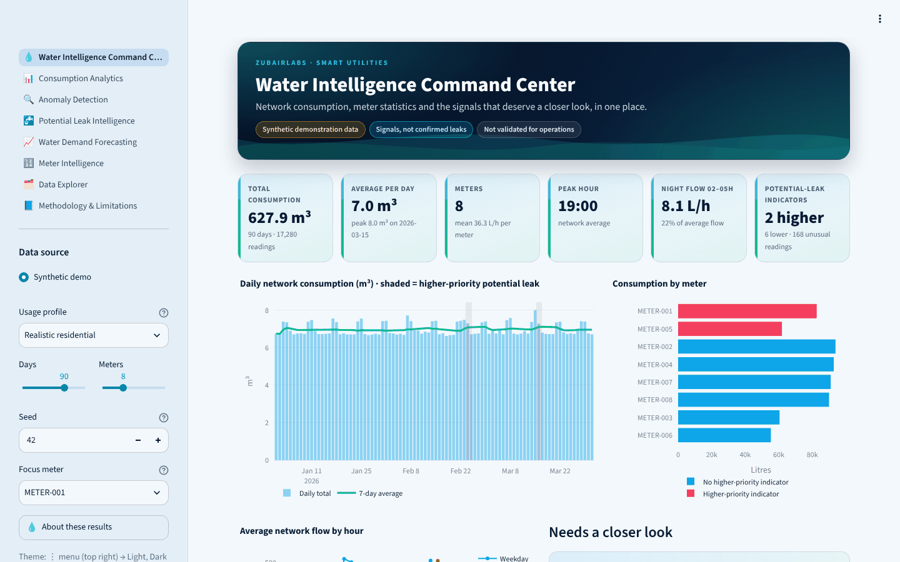</p>
<p align="center"><sub>Real screenshot · Command Center · light theme · synthetic realistic profile</sub></p>

## 3. Features

| Module | What you get |
|:--|:--|
| 💧 **Command Center** | Six KPI cards: volume, average day, meters, peak hour, night flow and indicators. Also daily consumption with leak episodes shaded, consumption by meter coloured by indicator status, weekday vs weekend hourly profile, and a "needs a closer look" list |
| 📊 **Consumption Analytics** | Meter and date filters; stacked daily consumption by meter; hourly profile with a 10th–90th percentile band; weekday × hour heatmap; top-10 network peak hours; daily totals by weekday; CSV export |
| 🔍 **Anomaly Detection** | Context-aware or original method; expected-rate control; higher/lower filter; zoomable timeline with the typical-for-the-hour line; volume per meter; hour-of-day distribution; explained table; synthetic check panel; CSV export |
| 🚰 **Potential Leak Intelligence** | Adjustable window, ratio, minimum excess and minimum length; episode table with priority, excess litres and night hours; episode inspector with injected truth overlaid (demo); meter × night heatmap; synthetic check vs the original rule; two CSV exports |
| 📈 **Water Demand Forecasting** | Any meter or the network total; 6–72 h horizon; forecast with an empirical error band; day-ahead and one-step tables against baselines; error by hours ahead; holdout chart; feature importance; CSV and JSON exports |
| 🔢 **Meter Intelligence** | Meter summary table: share, peak hour, night ratio, load factor, variability, week-on-week change, episodes. Also normalised daily shapes, daily totals, a flow vs night-ratio map and a meter × hour usage fingerprint |
| 🗂️ **Data Explorer** | CSV upload with a validation report; data contract; two downloadable samples; meter and date filters; preview; four downloads (readings, daily totals, meter summary, validation report) |
| 📘 **Methodology** | Data, models, evaluation and limitations, plus live synthetic results at the current settings |

Also included:
- light and dark themes, ZubairLabs branding and a water-wave hero
- a session-safe data-source switch and a global focus-meter selector
- friendly empty and error states
- a command-line report script (`scripts/evaluate.py`)

## 4. System architecture

<p align="center">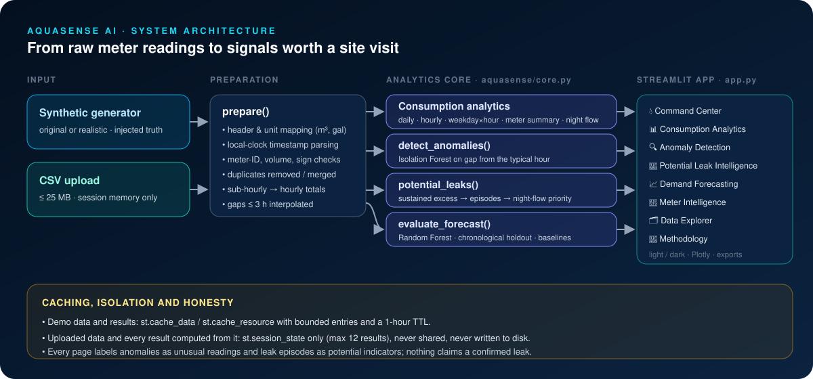</p>

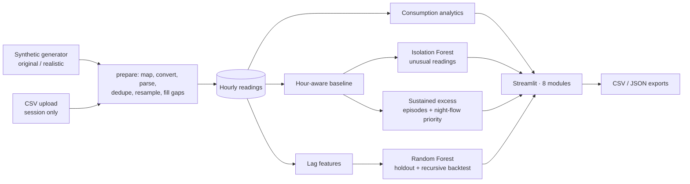

## 5. Data processing workflow

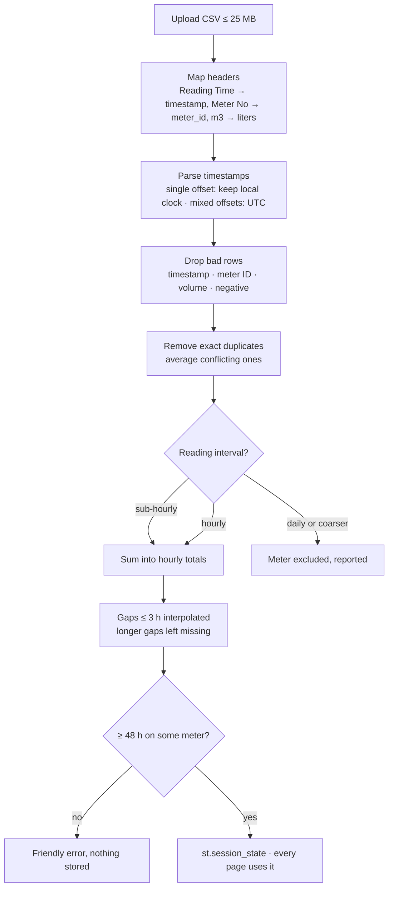

The included `sample_data/messy_upload_example.csv` (6,025 rows) exercises every branch:
- **Format:** 15-minute readings in m³ with a `+05:00` offset and renamed headers.
- **Bad rows:** one unparseable timestamp, a blank meter ID, two non-numeric volumes and a negative value.
- **Duplicates:** 10 exact duplicates and 2 conflicting ones.
- **Gaps and coarse data:** a 2-hour gap, a 12-hour gap and a daily-only meter.
- **Result:** 1,500 clean hourly readings for 3 meters. Everything above is counted in the report, and `WM-DAILY` is excluded with a reason.

## 6. Machine-learning methodology

| Step | Choice | Why |
|:--|:--|:--|
| Hourly grid | Every meter reindexed to a regular hourly series before any lag | The original `shift()` on rows silently mis-aligned lags whenever a file had gaps |
| Typical value | Median of the same hour on earlier days of the same type (10 weekdays / 4 weekend days, min 3), past only | Removes the daily cycle and weekend shift; a test confirms changing the future never changes past baselines |
| Anomalies | `IsolationForest(200 trees, contamination=rate)` per meter on reading, gap from typical, 3-hour mean gap | Flags what is unusual *for that hour*, not just high readings |
| Leak indicators | Trailing mean vs typical, ratio and absolute excess, runs ≥ 6 h, night-flow priority | Turns hour-level noise into a short, explainable list |
| Forecast features | hour, weekday, previous hour, same hour yesterday, trailing 24-h mean (all past only) | The original feature set, kept |
| Forecaster | `RandomForestRegressor(100 trees, min_samples_leaf=3, random_state=42)` | Unchanged from v1 |
| Split | Chronological: first 80% of hours train, last 20% holdout | No shuffling, so no look-ahead |
| Metrics | MAE, RMSE, bias for one step ahead *and* a recursive day-ahead backtest | The app shows recursive forecasts, so that is what must be scored |
| Baselines | Same hour on the last observed day; hour-of-day average of the last 14 training days | A model only matters if it beats these |
| Forecast band | 10th–90th percentile of backtest errors per hours-ahead | Empirical, not a calibrated probability |

## 7. Forecasting, anomaly and leak-indicator details

<p align="center">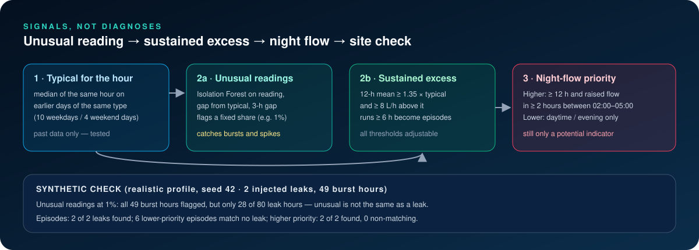</p>

**Why two forecast metrics?** v1 reported only one-step-ahead errors, where each prediction sees the real previous hour.
The dashboard, however, shows 24–72-hour *recursive* forecasts, where predictions feed later lags. The backtest
reproduces that exactly:
- **Origins:** one at every 23:00 in the holdout, 17 for 90 days of data.
- **Model:** trained on the first 80% only.
- **Inputs:** no actual values after each origin. A test multiplies every later reading by 3 and confirms the forecasts from that origin do not change.

**Why rank by night flow?** Homes use very little water between 02:00 and 05:00, so a continuous leak stands out there.
A tap left on in the evening or a day of guests doesn't. On the realistic synthetic data, every lower-priority episode
had zero raised night hours. Both injected leaks had raised night flow on three of the night hours checked.

**Why keep the original methods?** The v1 anomaly model (raw reading, hour, weekday) and v1 leak rule (rolling mean vs
an all-hours median) are still in `aquasense/core.py`, selectable in the app and scored side by side. The
improvements are therefore measured, not asserted.

## 8. Dataset documentation

| Column | Type | Description |
|:--|:--|:--|
| `timestamp` | datetime | Start of the hourly interval (local clock) |
| `meter_id` | text | `METER-001` … in the demo |
| `liters` | float | Volume used in that hour (L), ≥ 0 |
| `injected_leak` | bool | *Truth, demo only:* +27 L/h for 40 h on every fourth meter |
| `injected_burst` | bool | *Truth, realistic profile only:* 1–3 legitimate 2–4 h bursts of +35–60 L/h per meter |

| Profile | Daily shape | Night flow | Purpose |
|:--|:--|:--|:--|
| **Original (v1)** | `13·sin²((h−7)π/12)` + 8 L/h in 06–09 and 18–22 | ≈ average flow (ratio 1.0) | Reproduced exactly (tested), incl. `data/synthetic_water_meters.csv` |
| **Realistic residential** (app default) | Low night, 07–08 and 19–20 peaks, weekend mornings two hours later | ≈ 22% of average | Makes night-flow analysis meaningful and adds legitimate bursts |

Both profiles share the same random draws: baselines of 18–42 L/h, noise σ = 3.2 and identical leak timing. The default
demo is 90 days × 8 meters = 17,280 readings (627.9 m³ in the realistic profile). Downloadable samples:
- `data/synthetic_water_meters.csv` (original, 14 days × 4 meters)
- `sample_data/realistic_sample.csv` (21 days × 4 meters)
- `sample_data/messy_upload_example.csv`

**Upload contract:** `timestamp, meter_id, liters`. Common alternatives are recognised (`datetime`, `meter`, `litres`,
`m3`, `gallons`, …), and readings must be hourly or more frequent. Limits:
- at least 2 days per meter for analytics and 96 hours for the models
- up to 200 meters, 500,000 rows and 25 MB

Ambiguous dates such as `01/02/2026` are read month-first.

## 9. Technology stack

| Layer | Tools |
|:--|:--|
| App | Streamlit (`st.navigation`, custom CSS, light/dark `config.toml` themes) |
| Data | pandas, NumPy |
| ML | scikit-learn: `IsolationForest`, `RandomForestRegressor` |
| Charts | Plotly Graph Objects / Express |
| Testing | pytest, Streamlit `AppTest`, Playwright (Chromium) |
| CI | GitHub Actions: Python 3.11 and 3.12, plus a browser job |
| Hosting | Streamlit Community Cloud (free) |

## 10. Application screenshots

All images below are **real screenshots** of the running app (local run; live-site screenshots are added in section
16 after deployment). The illustrations in sections 4 and 7 are hand-made diagrams.

| | |
|:--:|:--:|
| 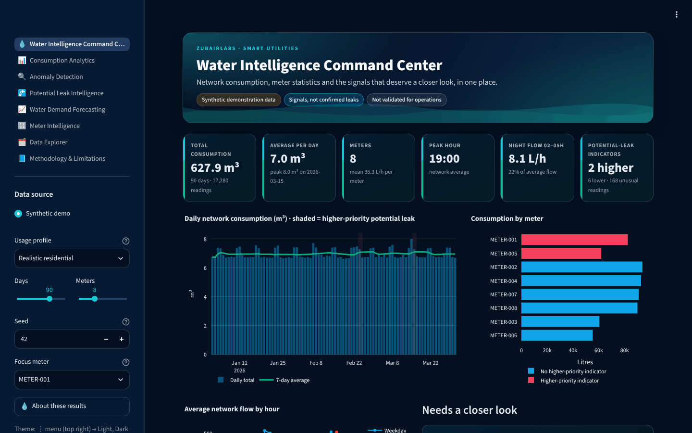 | 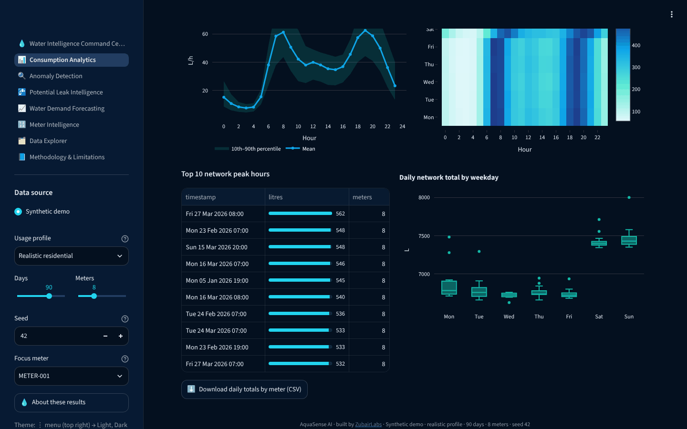 |
| Command Center · dark | Consumption Analytics · hourly profile and weekly rhythm |
| 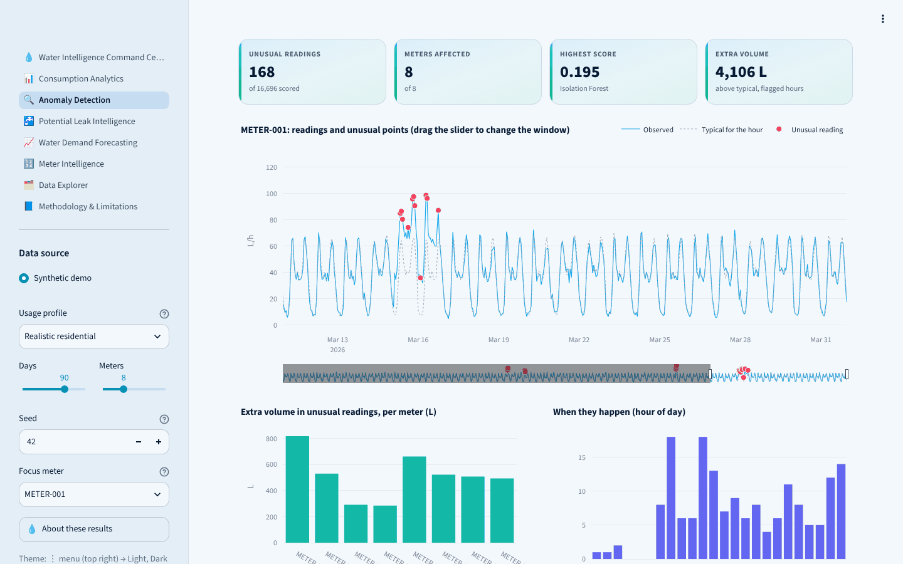 | 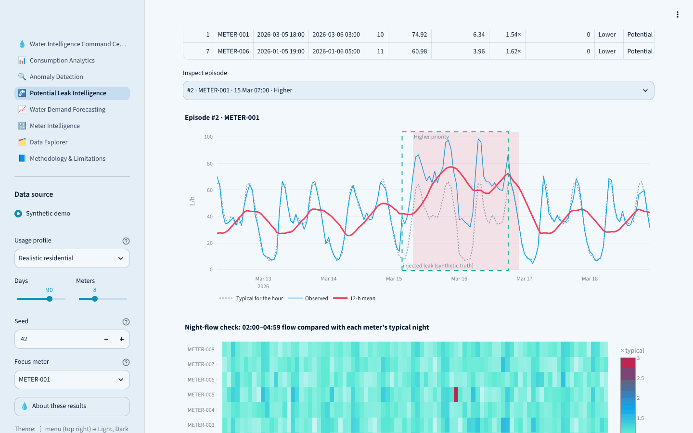 |
| Anomaly Detection · zoomable timeline | Potential leak episode vs injected truth (dashed) |
| 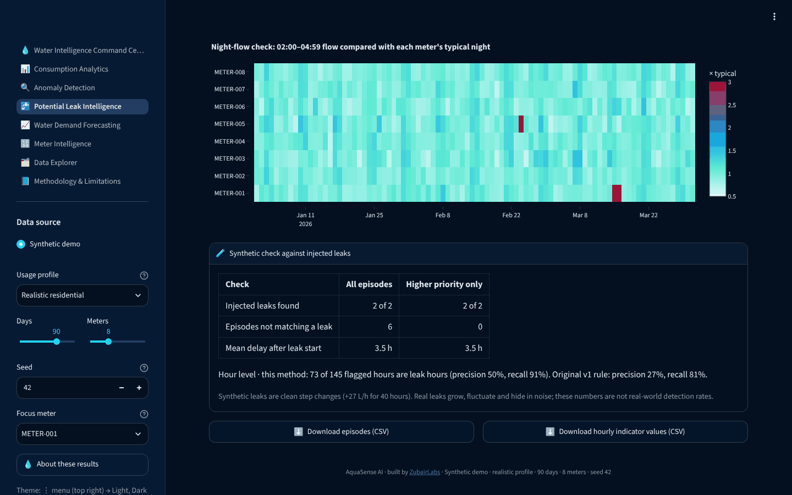 | 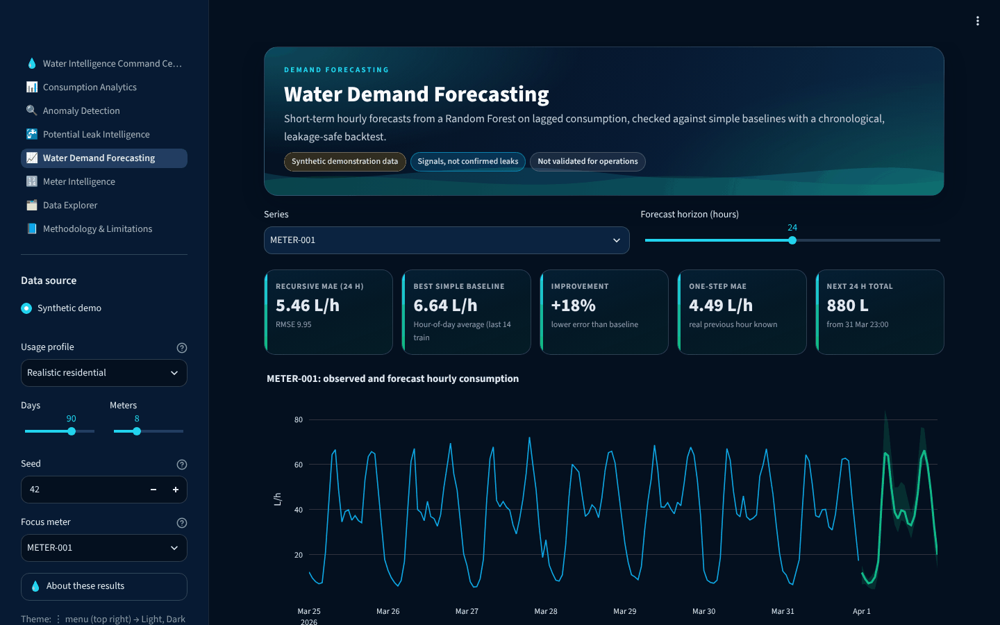 |
| Night-flow check and synthetic scores | Demand forecast with error band |
| 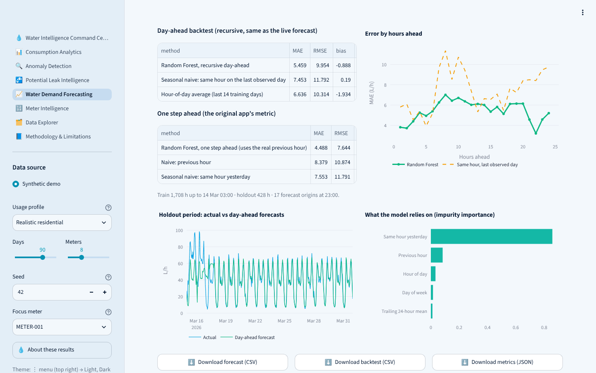 | 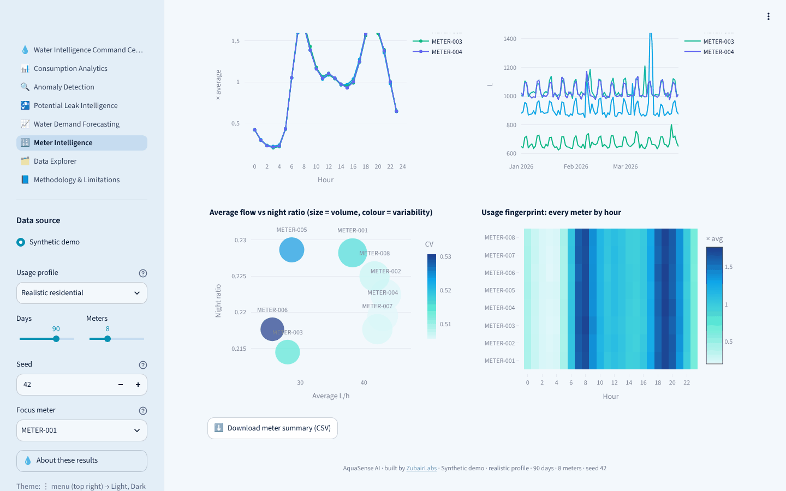 |
| Backtest tables, error by horizon, importance | Meter map and usage fingerprint |
| 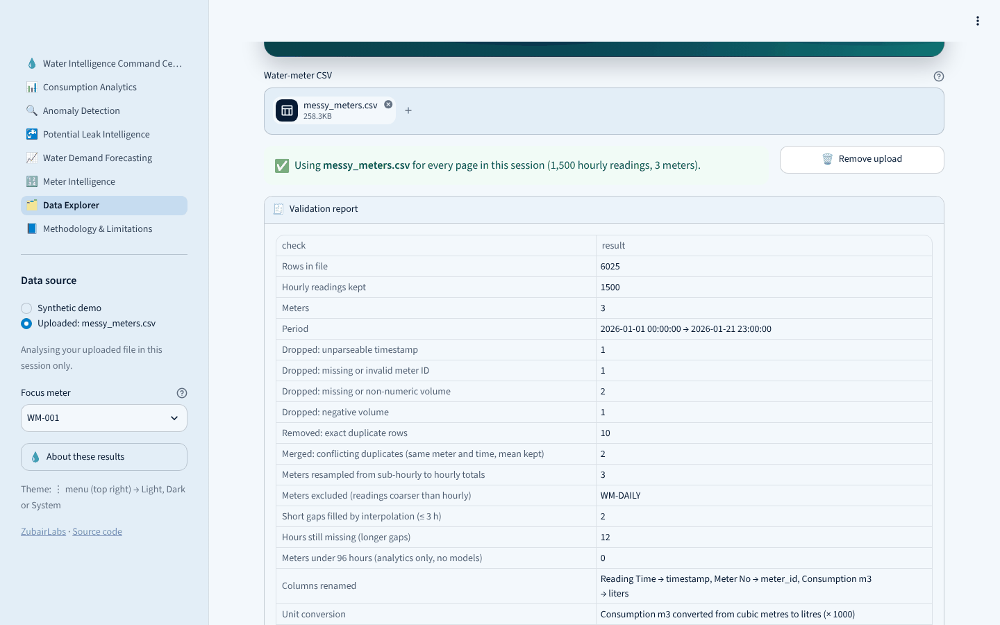 |  |
| Messy 15-minute upload · validation report | Command Center · light |

## 11. Evaluation results

Every number comes from `python scripts/evaluate.py` on synthetic data (seed 42, 90 days, 8 meters) under the pinned
deployment versions (Python 3.12, pandas 2.3.3, scikit-learn 1.9.1). CI checks the key claims.

**Potential-leak indicators** (2 injected leaks of +27 L/h for 40 h):

| | Realistic profile (default) | Original profile |
|:--|--:|--:|
| Episodes (all) | 8 | 2 |
| Injected leaks found by any episode | 2 of 2 | 2 of 2 |
| Episodes matching no leak | 6 (all *lower* priority) | 0 |
| **Higher-priority episodes: leaks found / non-matching** | **2 of 2 / 0** | **2 of 2 / 0** |
| Mean delay from leak start | 3.5 h | 5.0 h |
| Hour-level precision / recall: this method | 50% / 91% | 89% / 88% |
| Hour-level precision / recall: original v1 rule | 27% / 81% | 87% / 85% |

The higher-priority result (2 of 2 found, 0 non-matching) also holds for seeds 1, 7 and 11 in both profiles. That's 8
runs, all tested in CI. Stricter settings (ratio 1.8, excess 15 L/h, 12 h) remove every false episode but miss one of
the two leaks; the app makes that trade-off visible.

**Unusual readings** (realistic profile, 1% expected rate, 168 flags):

| Check | Context-aware (default) | Original v1 |
|:--|--:|--:|
| Legitimate burst hours flagged | 49 of 49 | — |
| Injected leak hours flagged | 28 of 80 (35%) | — |
| Flags that land on a leak or burst | 77 of 168 (46%) | 73 of 175 (42%) |
| Same, at a 2% rate | 35% | 23% |

Anomaly detection catches every legitimate burst but only about a third of leak hours. Unusual does not mean leak,
which is why indicators and anomalies are separate modules.

**Day-ahead forecast** (recursive 24 h from 17 origins in the 20% holdout; MAE in L/h, realistic profile):

| Series | Random Forest | Same hour, last day | Hour-of-day average | RF one step ahead |
|:--|--:|--:|--:|--:|
| **Network total** | **15.50** | 27.73 | 29.61 | 11.31 |
| METER-001 *(leak in holdout)* | **5.46** | 7.45 | 6.64 | 4.49 |
| METER-002 | **2.97** | 5.06 | 4.86 | 2.85 |
| METER-003 | **3.03** | 4.60 | 3.68 | 3.00 |
| METER-004 | **2.58** | 4.91 | 4.40 | 2.40 |
| METER-005 | **2.62** | 4.34 | 3.61 | 2.56 |
| METER-006 | **2.73** | 4.09 | 3.39 | 2.76 |
| METER-007 | **2.97** | 5.03 | 4.76 | 2.78 |
| METER-008 | **3.08** | 5.01 | 4.89 | 2.76 |

What the table shows:
- **Realistic profile:** the Random Forest beats both baselines on all 9 series. It leans mostly on *same hour yesterday* (impurity importance 0.91 on METER-002).
- **Original profile:** a simple hour-of-day average is as good or better on 8 of 9 series (METER-002: 2.53 vs 2.75). That data is a fixed daily curve plus random noise, so there is nothing beyond the daily pattern to learn, and the app says so when it happens.
- **v1 metric preserved:** the original one-step metric (`forecast_meter`) is unchanged at 2.781 L/h on METER-002 (original profile).

## 12. Installation and quick start

```bash
git clone https://github.com/muhammadzubair-data/aquasense-ai-water-consumption-intelligence.git
cd aquasense-ai-water-consumption-intelligence
python -m venv .venv && source .venv/bin/activate      # Windows: .venv\Scripts\activate
pip install -r requirements.txt
streamlit run app.py                                     # http://localhost:8501
```

```bash
python scripts/evaluate.py --all-meters                       # numbers in section 11
python scripts/evaluate.py --profile original --all-meters
python scripts/evaluate.py --csv sample_data/messy_upload_example.csv --out reports/
```

The original API still works: `from src.analytics import generate_data, validate_data, add_anomalies, leak_signals, forecast_meter`.

## 13. Project structure

```text
aquasense-ai-water-consumption-intelligence/
├── app.py                         # Streamlit app: 8 modules, theming, session-isolated uploads
├── aquasense/
│   ├── __init__.py
│   └── core.py                    # data, prepare(), analytics, anomalies, leak indicators, forecasting
├── src/analytics.py               # backward-compatible import path from v1
├── scripts/
│   ├── evaluate.py                # CLI report (KPIs, synthetic checks, forecast evaluation)
│   └── make_messy_sample.py       # builds the messy upload example
├── tests/
│   ├── test_analytics.py          # the original 9 tests (unchanged)
│   ├── test_core.py               # 45 tests: generator fidelity, prepare(), leakage, indicators, forecasts
│   ├── test_app.py                # 18 Streamlit AppTest checks
│   └── e2e_ui.py                  # Playwright browser test (run in CI)
├── data/synthetic_water_meters.csv          # original sample (14 days × 4 meters)
├── sample_data/
│   ├── realistic_sample.csv                 # 21 days × 4 meters, realistic profile
│   └── messy_upload_example.csv             # exercises every validation branch
├── assets/                        # hero, logo, icon, diagrams, real screenshots
├── docs/MODEL_CARD.md · docs/PORTFOLIO.md
├── .streamlit/config.toml         # light/dark themes, 25 MB upload limit
├── .github/workflows/ci.yml
├── requirements.txt · requirements-dev.txt · pytest.ini
└── README.md
```

## 14. Automated testing

| Suite | Tests | Covers |
|:--|--:|:--|
| `tests/test_analytics.py` | 9 | The original tests, unchanged |
| `tests/test_core.py` | 45 | Generator identical to v1 (3 configurations + committed CSV); realistic shape; `prepare()` repairs counted exactly; volume conserved on resampling; units, aliases, time zones; error and limit cases; aggregates sum to totals; night flow finds the leak nights; regular grid; past-only baselines; anomaly rate; bursts vs leaks; context vs original precision; **leak indicators on 8 seed × profile runs**; threshold trade-off; past-only features; v1 metric unchanged; gaps on the grid; chronological split; **backtest never sees the future**; RF beats baselines (realistic); baseline wins (original); band and JSON; determinism |
| `tests/test_app.py` | 18 | All 8 pages render; uploaded data used on 6 pages; profile and method switches; leak settings change results; forecast series and horizon; v1 import path |
| `tests/e2e_ui.py` | browser | 8 pages with chart counts; leak-episode CSV (higher priority = METER-001 and METER-005); forecast JSON matches the KPI; messy upload and report; session kept across sidebar navigation; meter summary CSV; upload removal; bad-file error |

```bash
pytest -q                                   # 72 passed
pip install -r requirements-dev.txt && python -m playwright install chromium
streamlit run app.py & python tests/e2e_ui.py http://localhost:8501
```

## 15. GitHub Actions CI

`.github/workflows/ci.yml` runs on every push and pull request:
1. **Tests job** (Python 3.11 and 3.12): install, `compileall`, `pytest -q`, and the CLI on the demo and the messy sample.
2. **Browser job** (after tests pass): starts Streamlit, waits for `/_stcore/health`, runs `tests/e2e_ui.py` in headless Chromium, and prints the Streamlit log.

## 16. Streamlit deployment

1. Go to [share.streamlit.io](https://share.streamlit.io) → **Create app** → *Deploy a public app from GitHub*.
2. Repository `muhammadzubair-data/aquasense-ai-water-consumption-intelligence`, branch `main`, main file `app.py`.
3. **Advanced settings → Python 3.12.** No secrets are needed.
4. Deploy. The first visit generates the demo and trains models in a few seconds; results are cached for an hour.

Notes:
- Forecasts are evaluated only for the series you open (about 1–2 s each).
- Uploaded data and its results live in `st.session_state` only.
- After pushing changes to `aquasense/core.py`, use **Manage app → Reboot** so the new module is loaded.

## 17. Limitations and roadmap

**Limitations**
- Synthetic data only. Injected leaks are clean +27 L/h steps; real leaks grow, fluctuate and hide in noise.
- No confirmed leak labels, and no pressure, acoustic or district-metered-area data. Confirming a leak needs field work.
- Meters are treated independently, so network leaks between a district meter and customer meters are out of scope.
- The contamination rate and indicator thresholds are assumptions that trade missed events against false alarms.
- Recursive forecasts compound error; the band is empirical, not calibrated. Weather, holidays and occupancy aren't modelled.
- Uploads should not contain customer names, addresses or account numbers; this is a public demo.

**Roadmap**
- Minimum-night-flow trend alerts with change-point detection
- District-meter vs sum-of-customers balance (non-revenue water)
- Weather and holiday features; quantile forest for calibrated intervals
- Alert feedback loop (confirmed / dismissed) to tune thresholds per meter
- Scheduled PDF summary per meter

## 18. Author

**Muhammad Zubair** · ZubairLabs: data analytics, BI dashboards and applied machine learning for startups and SMEs.

- 🌐 [zubairlabs.com](https://zubairlabs.com)
- 💻 [github.com/muhammadzubair-data](https://github.com/muhammadzubair-data)
- 💼 [LinkedIn](https://www.linkedin.com/in/xubbiofficial/)

<sub>Synthetic demonstration. Anomalies and potential-leak indicators are not confirmed leaks and are not validated for operational use.</sub>
