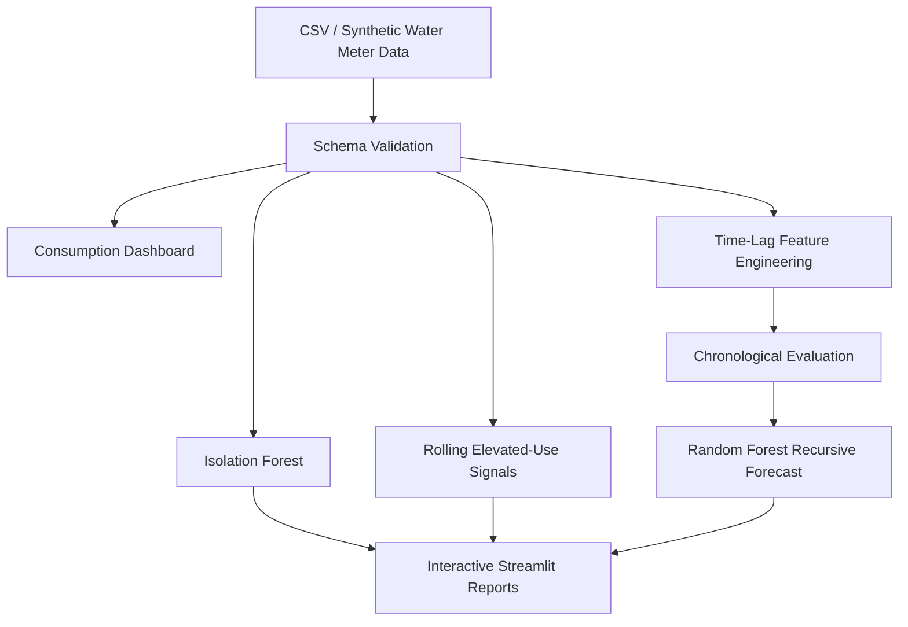

# 💧 AquaSense AI
### Smart Water Consumption, Leak Detection Signals & Usage Forecasting Intelligence

**ZubairLabs | Data • AI • Analytics**

A reproducible demonstration of water-meter analytics, unusual-usage detection, heuristic sustained-use signals, and short-horizon demand forecasting. **Uses synthetic data; not a certified leak-detection system.**

## Features
- **Command Center:** Consumption totals, meter comparisons, daily trends.
- **Anomaly Detection:** Isolation Forest per meter with anomaly visualizations and CSV export.
- **Elevated-Use Signals:** Rolling consumption compared with expanding historical baseline; flags are not confirmed leaks.
- **Demand Forecast:** Random Forest using lagged consumption and time features; chronological holdout MAE/RMSE and recursive 6–72-hour forecasts.
- **Data Explorer:** Upload and validate custom CSVs, select meters, download results.

## Architecture


## Quick start
```bash
python -m venv .venv
# Activate the virtual environment for your operating system
pip install -r requirements.txt
streamlit run app.py
```

## Tests
```bash
python -m pytest -q
```

## CSV format
`timestamp,meter_id,liters` — one timestamp per meter, no negative or missing consumption values. Download a sample CSV from the sidebar.

## Important limitations
- The synthetic dataset is illustrative, not a real utility dataset.
- Statistical anomalies and elevated-use patterns are **not proof of leaks**; legitimate use changes can trigger them.
- Forecast holdout uses known historical lag features; future predictions are recursive and may compound errors.
- There is no sensor integration, pressure data, validated leak labels, or production monitoring.
- Uploaded data is processed in the app session; avoid uploading sensitive meter or customer information to public demos.

## Deployment
Push this repository to GitHub, then create a Streamlit Community Cloud app using `app.py` as the entry point and `requirements.txt` for dependencies. Verify public URL before adding a live badge.

## Author
[ZubairLabs](https://zubairlabs.com) · [GitHub](https://github.com/muhammadzubair-data)
